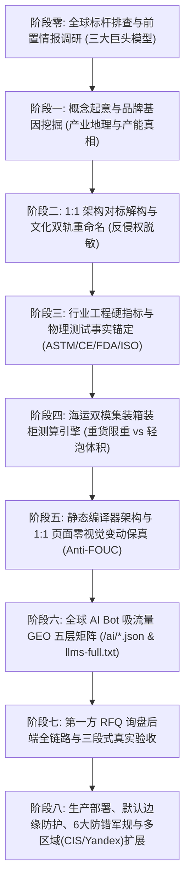

# B2B Global Brand Site Master · V2.3 全生命周期 8 阶段 SOP 与 GEO 五层吸流版

将企业真实事实转化为海外专业买家能理解、能比较、能询盘，且全球传统搜索与生成式 AI 引擎（ChatGPT Search、Perplexity、Claude、Google AI、Яндекс Нейро）能高置信引用的世界级品牌门户。本版本深度融合了 `b2b-limestone-geo-site-builder`（天涯石业 `tianyalimestone.com`）与 `b2b-bento-geo-site-builder`（耐克便当盒 `custombentofactory.com`）千次实战淬炼出的 **“8 大构建阶段：从前置情报发现到全行业通用 SOP”**。

---

## 🏛️ 全生命周期 8+1 构建阶段全景架构 (Universal 8-Stage SOP)



### 阶段零：全球标杆排查与前置情报调研 (Benchmark Reconnaissance)
面对任何新行业或新企业，严禁直接套用廉价白牌模板。先执行前置情报穿透，锁定该细分赛道的 **“全球三大巨头模型”**：
1. **技术规范与 GEO 第一引用源**：垄断公建/工业标准（CSI 规范、ASTM/FDA/ISO 检测指标、CAD/BIM 模型），吸纳其**工程参数结构与硬核证据**（如石材 `polycor.com`、五金 `mcmaster.com`）；
2. **高端设计美学与高溢价天花板**：垄断杂志级留白、高级字阶与顶奢实景，终端售价为中国工厂出厂价的 3–6 倍，吸纳其**视觉版式与沉浸式选型交互**（如石材 `eco-outdoor.com`、便当盒 `bentgo.com`）；
3. **场景长尾词与选型指南之王**：按应用空间、表面工艺、规格建立高密度主题集群（Topic Clusters），吸纳其**分类导航与选型指南架构**（如石材 `mandarinstone.com`）。

$$\text{中国出海品牌独立站} = \text{标杆 2 的视觉美学} + \text{标杆 1 的国际标准工程真相} + \text{标杆 3 的长尾分类架构} + \text{中国源头工厂产能与 FOB 出厂价优势}$$

### 阶段一：概念起意与品牌基因挖掘 (Conceptualization & Brand Truth)
- 识别企业主体、中国核心产业带地理坐标（如水头石都、慈溪家电餐厨、永康五金等）、核心出海港口距离、自营厂房设备（如排锯、五轴桥切机、高精注塑机群）与真实月产能；
- 以标杆信息架构为骨架，聚焦高毛利核心品类，未知事实列入 `private/gaps.md`，绝不将行业常见值冒充为该企业事实。

### 阶段二：文化双轨重命名与图实一致严苛质检 (Dual Trade Naming & Material Alignment)
- **文化双轨重命名**：彻底剥离对标网站的专有商标（Trademark），借助中国传统文化（营造法式、二十四节气、东方山河）或现代工业美学建立双轨命名：
  - 主商品名：`[文化拼音/系列名] [表面工艺/功能结构] [标准品类词]`（如 `Guyu Tumbled Limestone Pavers`）
  - 副标题：`[意境英文] · [中文原名] ([色系/材质/纹理特征])`（如 `Spring Warm Cream · 谷雨`）
- **图实一致性铁律**：产品微距特写优先采用工厂真实实拍；配套的应用场景图必须在材质、色调（色差 $\Delta E < 5$）、表面肌理、边缘工艺上与特写 **100% 像素级对齐**，严禁跨款式混用。

### 阶段三：工程硬指标与物理测试事实锚定 (Engineering Truths)
- 全站拒绝空洞形容词，以经核准的权威标准参数表（如建材 `ASTM C97/C170/C880/AS 4586 P4-P5`、餐厨 `FDA 21 CFR 177.1520 / LFGB / -50kPa 防漏`、机械 `ISO 2768`）作为买家比较与 AI 引用的事实锚点。

### 阶段四：海运双模集装箱装柜测算引擎 (Dual-Mode Container Logistics Math)
- 内置 `scripts/design_math.py` 双模算力，严防把重货当轻泡货算导致超重爆柜：
  - **外箱体积/重量双约束模式 (`container`)**：适用于便当盒、家电、包装、日用品，同步测算 20GP / 40GP / 40HQ 箱数與件数；
  - **重货限重硬瓶颈模式 (`stone-container`)**：适用于天然石材、岩板、铸件等高密度重货（如石材 $\rho = 2,620\text{ kg/m}^3$，20GP 限重 `26,500 kg`，20mm 标板单柜安全上限 `480–504 m²`，30mm 约 `320–336 m²`）。

### 阶段五：静态编译器架构与 1:1 页面零视觉变动保真 (Compiler Architecture)
- 同一套核准事实卡（`content/public-facts.json`）驱动 HTML、Schema.org JSON-LD、`sitemap.xml` 与 GEO 知识端点；
- 对既有高水准页面做 SEO/GEO 升级时，严格保持原有 CSS 样式网格 100% 不变，仅针对 `<head>` 元数据、结构化数据与机器可读端点做无损注入。

### 阶段六：2026 全球 AI Bot 吸流量 GEO 五层技术矩阵 (GEO 5-Layer Matrix)
开启 `"llms": true` 并执行 `--release` 构建时，编译器自动生成面向生成式 AI 的五层截流体系：
1. **爬虫协议层 (`robots.txt` & `sitemap.xml`)**：显式声明搜索与 AI 爬虫规则及规范 Sitemap；
2. **双轨 LLM 协议层**：轻量导航 `/llms.txt` + 全量工程采购手册 `/llms-full.txt`；
3. **四大机器可读 JSON API 层**：`/ai/summary.json`、`/ai/products.json`、`/ai/faq.json`、`/ai/vendor-comparison.json`（严格同源投影，零私有字段泄露）；
4. **深度语义图谱层 (`Schema.org`)**：页面级 `WebPage` + `Organization` + 行业扩展 `Product` / `FAQPage`；
5. **事实锚点正文与数据铁律**：采用 Princeton GEO 三句式答案块；所有市场价格/运费估算必须标注 *Indicative 估算免责声明* 并导向正式询价。

### 阶段七：第一方询盘后端全链路与三段式验收 (First-Party RFQ)
- 默认提供零依赖 `email_draft` 邮件草稿模式；
- 生产环境接入 `http` 模式（推荐 Cloudflare Worker `/api/inquiry` + Turnstile 服务端 `siteverify` 验签 + 隐形蜜罐 + 邮件/CRM 投递），失败必须返回真实错误并保留用户输入；
- **三段式端到端验收**：① 假 token 探针返回 `403` $\rightarrow$ ② 真机人工通过 Turnstile 提交成功 $\rightarrow$ ③ 销售收件箱确认收到真实邮件。

### 阶段八：默认站点防护、6 大防错军规与多区域扩展 (Protection, Guardrails & CIS/Yandex)
- 默认生成 Cloudflare Workers 边缘防护包（公开路径白名单、高频读取限流、询盘独立限流、防 iframe 镜像嵌套）；
- 支持面向俄罗斯、哈萨克斯坦、乌兹别克斯坦等独联体（CIS/EAEU）市场的 Yandex SEO（`Clean-param`、`hreflang`、IndexNow 秒级推送）与 ГОСТ 标准对标矩阵。

---

## 按需读取

1. **8 阶段通用 SOP 与跨行业 5 步母模板**：读 [标杆发现与 8 阶段通用 SOP](references/benchmark-discovery-methodology.md) 和 [6 大失败案例与防错军规](references/failure-cases-and-guardrails.md)。
2. **启动及选择行业**：读 [行业选择与交付规则](references/industry-routing.md)，从 [22 行业配置](assets/industries.json) 只取匹配项（含 `bento` 便当盒餐厨与 `limestone` 天然石灰石建材）。
3. **摄取事实及构建知识库**：读 [知识与资产契约](references/knowledge-assets.md)，复用 RenWork V4 Schema 和 00–20 模块。
4. **设计与实现**：读 [品牌及页面模板](references/site-blueprints.md)、[网页设计、排版与交互验收](references/web-design.md) 与 [采购组件](references/procurement-components.md)。
5. **SEO / GEO 五层矩阵及上线**：读 [GEO 五层吸流手册](references/geo-ai-citation-playbook.md)、[搜索与发布验收](references/search-release.md)、[最新平台核验](references/search-current.md) 与 [默认站点防护](references/site-protection.md)。
6. **运行契约与演进记录**：读 [运行与迁移](references/runtime.md)、[研究依据](references/research.md) 与 [V2 融合差异](references/fusion-v2.md)。

---

## 不可丢失的约束

- 企业证据与行业知识分开。行业常见 MOQ、交期、标准、工厂面积不能变成该企业事实。用户未说明的制造商身份也不能从产品图片推断。
- 页面、JSON-LD、`llms.txt`、`llms-full.txt` 和 `/ai/*.json` 只使用允许公开的事实投影。内部成本、客户名单、联系人隐私、`source_refs`、`tenant_id` 不进入公开构建目录。
- 公开宣传素材必须有使用权。AI 概念图标明示意用途；不能伪装为实拍厂房、设备、员工、客户项目、认证或测试结果。产品特写与场景渲染图必须严格执行**图实一致性核查**。
- 不机械执行固定关键词密度、文章字数、页面数量或“GEO 100 分”。不伪造作者、评价、Offer、实体档案、证书、客户 Logo 或近期更新时间。

---

## 工作成果

| 层 | 交付物 | 完成标准 |
|---|---|---|
| 前置情报与标杆 | 赛道 Top 3 标杆解构表、文化双轨命名规划表 | 明确视觉标杆、工程规范标杆、长尾词标杆与反侵权命名方案 |
| 输入与证据 | 原始 Logo/简介、来源清单、事实卡、缺口清单 | 保留来源定位、时间、授权范围与公司 ID |
| 品牌 | `DESIGN.md`、Tokens/CSS、Logo 使用规范、语气与定位 | 明确品牌色、字体许可、采购受众、移动端规则 |
| 知识 | 00–20 模块覆盖表、知识卡、岗位视图、公开事实投影 | 有信息才填事实；未接 CRM 标注未接入 |
| 行业站点 | IA、页面 brief、文案、源代码、本地预览 | 页面服务真实买家问题，参数/证据/CTA 完整 |
| 数字资产 | Logo 派生、网页图片、OG、下载资料、素材台账 | 每项有版本、来源、许可、事实关联、图实一致性核验 |
| 搜索与 GEO 转化 | 主题地图、Clean URLs、Schema、sitemap、`llms-full.txt`、`/ai/*.json`、RFQ | 技术验收、交付回执、搜索与 AI 端点分别记录 |
| 运维与防护 | `acceptance.md`、Workers 防护包、更新清单、回滚说明 | 用 PASS/FAIL/NOT_RUN/BLOCKED 附证据，不用一句“全部完成” |

---

## 一条命令与核心工具链

以本 Skill 目录为工作目录，创建带独立私有资料目录的项目并运行全套编译、测算与校验：

```bash
# 1. 查看 22 大行业配置并初始化企业项目
python3 scripts/sitekit.py industries
python3 scripts/orchestrator.py --name "Example Company" --intro-file /path/intro.txt --industry limestone --logo /path/logo.png --out /path/company-project

# 2. 编译草稿或发布候选 (当 site.json 中 llms=true 时，--release 自动生成 llms.txt, llms-full.txt 及 /ai/*.json)
python3 scripts/orchestrator.py --project /path/company-project
python3 scripts/orchestrator.py --project /path/company-project --release

# 3. 运行站点完整性、Clean URLs、Schema 与私有边界审计 (必须 0 errors)
python3 scripts/validate_site.py /path/site-output --release --domain https://example.com

# 4. 设计数学、防御性 URL 拼接与双模集装箱装柜算力 (外箱体积模式 + 重货石材限重模式)
python3 scripts/design_math.py contrast '#334155' '#ffffff'
python3 scripts/design_math.py fluid 36 64 360 1440
python3 scripts/design_math.py safe-url https://example.com products/item
python3 scripts/design_math.py container --length 540 --width 380 --height 420 --weight 14.5 --pcs 24
python3 scripts/design_math.py stone-container --area 480 --thickness 20 --density 2620

# 5. 本地询盘守护服务与全量回归测试套件
python3 scripts/rfq_daemon.py --port 8012 --emails info@example.com
python3 tests/check_pipeline.py
python3 tests/check_validator.py
node tests/check_estimator.mjs
node tests/check_inquiry.mjs
node tests/check_protection.mjs
python3 scripts/design_math.py self-test
```

---

## 🌐 全站默认无 HTML 后缀规范 (Clean URLs Policy)

所有生成的独立站与门户，默认禁止在内链或公开 URL 中暴露 `.html`：
- **内链**：首页用 `href="/"` 或 `href="./"`，二级页用 `href="/products/"` 或 `href="products"`；
- **SEO/GEO**：Sitemap `<loc>`、`<link rel="canonical">`、`<meta property="og:url">`、JSON-LD 结构化数据与 `/ai/*.json` 全量采用 Clean URLs；
- **服务器适配**：输出包默认适配 Cloudflare Workers Clean URLs、`vercel.json`、`nginx.conf` 与 `.htaccess` 无后缀重写配置。

---

## 🛡️ 防排版乱码与样式崩坏规范 (Anti-FOUC & Layout Stabilization Policy)

针对海外独立站发布后常见的“排版错乱、弹窗/抽屉裸露溢出、带 emoji 列表铺屏、乱码”问题，强制执行以下四大防错基线：
1. **静态资产内容哈希 / 版本化缓存穿透 (Cache-Busting)**：
   - 严禁在 HTML 中输出无版本号的裸 `<link rel="stylesheet" href="/css/site.css">`；
   - 必须为 CSS/JS 自动附加内容 SHA-256 哈希或构建版本号（如 `/css/site.css?v={hash}`），彻底规避 CDN 边缘旧缓存导致“新 HTML 引用旧 CSS”引发的样式灾难；
2. **隐藏式组件防御性隐藏 (Defensive Hidden Off-Canvas Isolation)**：
   - 任何移动抽屉（Mobile Drawer）、指南针全站导航（Compass Modal）、询盘弹窗、侧边栏或下拉菜单，在 HTML 中必须具备 `hidden` 属性，并在 `<head>` 关键 CSS 中声明 `display: none !important;`；
3. **字符集与字体编码安全 (UTF-8 & Font Safety)**：
   - HTML 顶端前 1024 字节内必须严格声明 `<meta charset="utf-8">`；
   - 导航与菜单优先采用 SVG 矢量图标或标准语义化排版，严禁孤立堆砌未经字体兜底的生僻 Unicode Emoji；
4. **服务器 HTTP 响应头分级治理 (Server Cache Headers Protocol)**：
   - HTML 页面下发 `Cache-Control: no-cache, no-store, must-revalidate`；带版本号的 CSS/JS 配置长效缓存。
