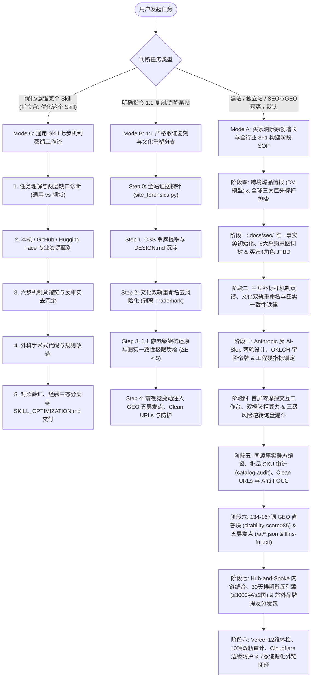

# B2B Global Brand Site Master · V3.1 四大技能大一统旗舰版

将企业真实事实转化为海外大买家深度信任、能完成工程选型与直接询盘，且全球传统搜索（Google、Bing、Yandex）与生成式 AI 引擎（ChatGPT Search、Perplexity、Claude、Google AI Overviews、Яндекс Нейро）能高置信引用的世界级品牌官网；同时具备跨领域通用 Skill 机制蒸馏与进化能力。

本版本（V3.1）完整融合了四大核心仓库与十大开源 SEO/GEO/CRO 技能精髓：
1. **`b2b-global-brand-site-master` (V2.2)**：22 大行业采购蓝图（`M0/M1/M2` 数据成熟度分级）、RenWork V4 7 态 21 模块事实治理、21 字段数字资产防伪台账、同源静态编译器与 Cloudflare Workers 默认边缘防护；
2. **`b2b-limestone-geo-site-builder`**：从前置标杆情报发现、全球三大巨头解构、文化双轨重命名、工程标准锚定、重货/轻泡双模装柜算力到 GEO 五层吸流端点（`/ai/*.json` & `llms-full.txt`）的 **8 大构建阶段全行业通用 SOP**；
3. **`renwork-web-create-skill` (V4.3)**：**三轨路由矩阵（Mode A 原创 / Mode B 1:1 复刻 / Mode C 通用 Skill 蒸馏）**、B2B & B2C 跨境产品情报 DVI 引擎、采购委员会 4 大角色 JTBD、Anthropic `frontend-design` 反 AI-Slop 两轮设计法、Vercel `web-design-guidelines` 12 维界面体检审计器与 **全自动 30 天排期行业智库长文发布引擎**；
4. **`b2b-seo-geo-site-master` (V4.0)**：**`docs/seo/` + `.claude/CLAUDE.md` 四阶段唯一事实源协同中枢**、6 大采购意图分支词树（`keyword-tree`）与哥飞 B2B 同行拆解法、Hub-and-Spoke 主题聚类与内链锚文本缝合（`topic-cluster`）、**134–167 词自包含 GEO 工程直答块与 0–100 分 `citability-score` 评分器**、批量 SKU 目录审计器（`catalog-audit`）、B2B 风险逆转与三级商业询盘卡、LinkedIn/Medium/YouTube 站外品牌提及分发包（`syndication-pack`）与 **7 态证据化外链台账（`backlink-ledger`）**。

---

## 🏛️ 核心架构：三轨路由矩阵与 8+1 构建阶段全景图



---

## 🚀 全生命周期 8+1 构建阶段详解 (Mode A & Mode B 贯通 SOP)

### 阶段零：跨境全链路产品情报穿透与全球三大巨头标杆排查
1. **B2B & B2C 跨境产品情报穿透（DVI 爆款模型）**：
   - 扫描五大信号源：**TikTok Shop**（高播病毒话题与开箱痛点）、**Amazon BSR & Movers**（1–3 星差评缺陷逆向改良）、**Google Trends**（Breakout 突变材质/功能词）、**Temu/Shein**（色彩趋势）、**全球海关提单 BOL**（HS 编码真实出货柜量）；
   - 按 7天（闪击）/ 14天（社交）/ 30天（主力）/ 60天（防守）/ 90天（壁垒）输出主力爆品矩阵与阶梯利润空间。详见 [`references/cross-border-product-intelligence.md`](references/cross-border-product-intelligence.md)。
2. **全球三大巨头标杆排查（Benchmark Reconnaissance）**：
   - 锁定细分赛道三类互补标杆：**标杆 1（技术规范与 GEO 第一引用源）** + **标杆 2（高端视觉美学与溢价天花板）** + **标杆 3（场景长尾词与选型指南之王）**。
   - **终极决策公式**：
     $$\text{出海品牌独立站} = \text{标杆 2 的视觉美学} + \text{标杆 1 的国际标准工程真相} + \text{标杆 3 的长尾分类架构} + \text{中国源头工厂产能与 FOB 出厂价优势}$$
   - 详见 [`references/benchmark-discovery-methodology.md`](references/benchmark-discovery-methodology.md)。

### 阶段一：`docs/seo/` 唯一事实源中枢、6 大采购意图词树与买家 4 角色 JTBD
1. **一键初始化 `docs/seo/` + `.claude/CLAUDE.md` 四阶段协同中枢（防多 Skill 指令打架）**：
   - 运行 `orchestrator.py` 或 `seo_geo_matrix.py init-workspace`，自动评估企业数据成熟度（**`M0` 仅 Logo+简介 / `M1` 含产品册+实拍+条款 / `M2` 含检测报告+案例+搜索数据**），并在项目下生成 12 个标准协同文件（`docs/seo/site-brief.md`、`keyword-matrix.json`、`topic-cluster.json`、`syndication-pack.json`、`cro-copy-deck.md`、`backlink-tracker.csv`、`status-log.md`、`src/styles/design-tokens.css`、`src/components/seo/B2bJsonLd.tsx`、`public/llms.txt`、`public/llms-full.txt`、`.claude/CLAUDE.md`）。
2. **6 大 B2B 采购意图分支词树 (`keyword-tree`) 与哥飞同行拆解法**：
   - 围绕核心产品词自动展开 6 大商业意图分支（`oem_odm_custom`、`manufacturer_supplier`、`bulk_wholesale_logistics`、`technical_spec_material`、`application_solution`、`comparison_alternative`），锁定每个着陆页的 **`h1_contract` / `h2_contract`**，剔除 C 端零售词与 SaaS 付费墙词；
   - 执行 **站 $\rightarrow$ 词 / 词 $\rightarrow$ 站** SERP 前 10 名弱点核验（内页排名、DR < 30 站点占比、B2B 供应商占比 $\ge 60\%$）；多语言严禁一键机翻，必须按目标国工业标准（德标 DIN、美标 ASTM、日标 JIS、俄标 ГОСТ）母语重研。详见 [`references/seo-geo-inquiry-playbook.md`](references/seo-geo-inquiry-playbook.md)。
3. **采购委员会 4 大角色 JTBD 与三层数据隔离**：
   - 为使用者、技术评估者、商业决策者、财务物流角色定制专属弹药；严格区分**企业事实 (Firm Truth)**、**公开观察 (Public Observation)** 与**待验证假设 (Hypothesis)**。详见 [`references/buyer-and-trade-research.md`](references/buyer-and-trade-research.md)。

### 阶段二：机制蒸馏、文化双轨重命名与图实一致性铁律
- **四种高阶机制蒸馏法**：对照学习（Top 10% vs 普通站）、反事实检查（删减不影响决策的冗余动效）、跨行业类比、失败蒸馏。详见 [`references/mechanism-distillation-and-creative-direction.md`](references/mechanism-distillation-and-creative-direction.md)。
- **文化双轨重命名（反侵权脱敏）**：彻底剥离对标站专有商标（Trademark），建立 `[文化拼音/系列名] [表面工艺/结构功能] [标准品类词]` + `[意境英文] · [中文原名]` 双轨命名体系。
- **图实一致性铁律（$\Delta E < 5$）**：微距产品特写优先采用工厂实拍；配套空间场景图必须在色调、表面肌理、结构细节上与特写 **100% 像素级对齐**。

### 阶段三：Anthropic 反 AI-Slop 两轮视觉导演、四大视觉原型与工程标准锚定
- **四大 B2B 工业视觉原型 (`B2B_VISUAL_ARCHETYPES`)**：自动映射 22 个行业至 `precision_engineering`、`cleanroom_regulatory`、`architectural_material`（含 `limestone`、`building-materials`、`bento` 等）与 `agile_oem_lookbook`，输出 Major Third (1.25) `clamp()` 流式字阶、OKLCH 染色中性灰（严禁纯灰 `#777/#888/#999`）、`1.8x–2.5x` 标题间距比与 12 列非对称工程网格（`src/styles/design-tokens.css`）。
- **两轮设计规划法（Two-Pass Design Planning）**：坚决剔除霓虹渐变字（`bg-clip-text`）、厚重软阴影卡片（`shadow-xl`）、虚假统计数字与 AI 套话（`in today's fast-paced...`、`look no further`）；遵循 **“大胆用在一处，克制留给全局”**。详见 [`references/frontend-design-anti-slop.md`](references/frontend-design-anti-slop.md)。

### 阶段四：首屏零摩擦交互工作台、海运双模装柜算力与三级风险逆转询盘漏斗
1. **首屏零摩擦交互工作台（Zero-Signup Friction Workbench）**：
   - 首屏直接内嵌材质/规格预设切换器、BOM 选型器或 20GP/40HQ 装柜测算器，产品页 CTA 通过 `/contact/?product=<Model>#inquiry` 自动预填客户意向型号。
2. **海运双模集装箱装柜测算引擎 (`scripts/design_math.py`)**：
   - **轻泡/标准外箱模式 (`container`)**：按外箱尺寸（mm）、毛重（kg）、装箱数（pcs）计算 20GP / 40GP / 40HQ 容量；
   - **重货限重硬瓶颈模式 (`stone-container`)**：针对天然石材、岩板、金属铸件等高密度重货（20GP 安全限重 `26,500 kg`，20mm 石材单柜安全上限 `480–504 m²`，30mm 约 `320–336 m²`）。
3. **B2B 风险逆转与三级商业询盘矩阵（彻底取代 SaaS 付费墙）**：
   - 严禁对 B2B 规格书设付费墙；配置 **Tier 1 标准样品包（NDA 保密 + 样品运费抵扣首单大货）**、**Tier 2 定制 OEM/ODM 图纸评估（大货前金样签字封样）**、**Tier 3 20GP/40HQ 整柜阶梯报价（支持 SGS/BV 装柜前验货）**，配合 `rfq_daemon.py`（HMAC 算术验证码 + 5 字段蜜罐 + JSON/CSV 双落盘 + 邮件分发）与 Turnstile 三段式真实验收。

### 阶段五：同源事实静态编译器、批量 SKU 审计 (`catalog-audit`)、Clean URLs 与 Anti-FOUC
- **同源事实驱动**：`content/public-facts.json` 唯一驱动 HTML、JSON-LD（`src/components/seo/B2bJsonLd.tsx`）、Sitemap 与 AI 知识端点，内部字段绝不外泄；
- **批量 B2B SKU 目录审计 (`seo_geo_matrix.py catalog-audit`)**：自动扫描 `skus.json` 中的重复标题、过短描述、AI 套话、缺失结构化规格字典、缺失 `alt` 与 `.html` 后缀违规；
- **全站默认 Clean URLs（零 `.html` 后缀）**与 **Anti-FOUC 四大防线**（CSS/JS `?v={hash}` 内容哈希、隐藏抽屉 `display:none!important`、前 1024 字节 UTF-8、内联 SVG）。

### 阶段六：134–167 词自包含 GEO 工程直答块、`citability-score` 评分器与五层端点
1. **0–100 分 B2B GEO 可引用性与反 AI-Slop 双轨评分器 (`seo_geo_matrix.py citability-score`)**：
   - 自动审计 HTML/JSX/Markdown 页面五大维度：① **120–180 词（黄金区间 134–167 词）自包含工程直答段落**（25分）、② **语义化 `<table>` 规格表与物理单位密度**（25分）、③ **零 AI 套话与零违规 UI 类名**（20分）、④ **单 H1 + 零 `.html` 内链 + 同源 JSON-LD**（15分）、⑤ **B2B 询盘漏斗链接闭环**（15分），要求核心页得分 **$\ge 85$ 分**。
2. **2026 全球 AI Bot 吸流量 GEO 五层技术矩阵**：
   - 开启 `"llms": true` 并执行 `--release` 构建时，自动编译 `/llms.txt`、`/llms-full.txt` 及 `/ai/summary.json`、`/ai/products.json`、`/ai/faq.json`、`/ai/vendor-comparison.json`；
   - 通过 `seo_geo_matrix.py geo-prompts` 生成 **6 大类买家 AI 搜索测试集（`GEO-01` ~ `GEO-06`）**。详见 [`references/geo-ai-citation-playbook.md`](references/geo-ai-citation-playbook.md)。

### 阶段七：Hub-and-Spoke 主题内链缝合、30 天排期智库引擎与站外品牌提及分发包
1. **Hub-and-Spoke 工程主题聚类与内链缝合 (`seo_geo_matrix.py topic-cluster`)**：
   - 以 `/products/`（品类总览 Hub）与 `/oem-odm/`（定制 Hub）为中心，规划材质对比、QC 验货清单、装柜优化、工况选型 4 类工程指南（Spoke），并在首 200 词与表格底部用精准技术锚文本向 Hub 页和 `/contact/#inquiry` 导流。
2. **30 天排期行业前沿智库发布引擎 (`scripts/scheduled_content_engine.py`)**：
   - 围绕 6 大核心选题支柱储备 30 天深度图文队列（每篇 **≥ 3,000 字**、**≥ 2 张高清工程图**），支持 `--audit-queue` 与 `--publish-due` 自动转正发布并更新 `sitemap.xml`。详见 [`references/scheduled-news-and-intelligence-engine.md`](references/scheduled-news-and-intelligence-engine.md)。
3. **站外品牌提及分发包 (`seo_geo_matrix.py syndication-pack`)**：
   - 一键生成 **LinkedIn 技术长文**、**Medium 工程选型专栏** 与 **YouTube 验厂/QC 视频 `.srt` 字幕脚本**（站外品牌提及对 AI 搜索引用的相关性权重为普通外链的 3 倍）。

### 阶段八：Vercel 12 维界面体检、默认边缘防护、7 态外链台账与 6 大防错军规
- **双轨自动化体检**：运行 `validate_site.py` + `layout_typography_auditor.py --strict`（Vercel 12 维 UI/UX 体检）+ `seo_geo_matrix.py citability-score`。详见 [`references/web-design-guidelines-audit.md`](references/web-design-guidelines-audit.md)。
- **7 态证据化外链与品牌提及台账 (`init-ledger` / `validate-ledger`)**：严格按 `candidate -> qualified -> filled -> submitted -> public -> indexed@<engine> -> rel_verified` 管理 `batch_directory`、`editorial_authority` 与 `brand_mention_surface` 三轨外链，未核实 `live_url` 与 `rel_attribute` 绝不虚报为有效外链。
- **默认站点边缘防护与 6 大防错军规**：每次构建生成 Cloudflare Workers 防护发布包（`READ_LIMITER=300/60s`、`INQUIRY_LIMITER=5/60s`、`verifiedBot` 豁免、`frame-ancestors 'none'`）。详见 [`references/site-protection.md`](references/site-protection.md) 与 [`references/failure-cases-and-guardrails.md`](references/failure-cases-and-guardrails.md)。

---

## 🧬 Mode C：通用 Skill 七步机制蒸馏与进化工作流

当用户输入包含 `优化这个 Skill：〈路径或仓库〉` 或要求升级任意领域 Skill 时，按 [`references/skill-optimization.md`](references/skill-optimization.md) 执行七步闭环：
1. **任务理解与基准诊断** $\rightarrow$ 2. **两层能力缺口诊断**（通用维度 vs 领域维度，**严禁向非外贸网站类 Skill 强加买家研究、关税或 SEO/GEO 规则**）$\rightarrow$ 3. **本机 / GitHub / Hugging Face 资源甄别** $\rightarrow$ 4. **六步机制蒸馏链** $\rightarrow$ 5. **外科手术式代码与规则改造** $\rightarrow$ 6. **对照验证与经验三态分类**（`[已验证]` / `[推导规则]` / `[待试验]`）$\rightarrow$ 7. **按 [`templates/SKILL_OPTIMIZATION.md`](templates/SKILL_OPTIMIZATION.md) 输出交付报告**。

---

## 按需读取导航

1. **四阶段 `docs/seo/` 唯一事实源协同、十大开源 SEO/GEO/CRO 技能取舍与快捷口令**：读 [B2B SEO+GEO 询盘获客作战手册](references/seo-geo-inquiry-playbook.md)。
2. **8 阶段 SOP、标杆发现与跨行业 5 步母模板**：读 [标杆发现与 8 阶段通用 SOP](references/benchmark-discovery-methodology.md) 和 [6 大失败案例与防错军规](references/failure-cases-and-guardrails.md)。
3. **跨境产品情报与买家/贸易研究**：读 [跨境全链路产品情报引擎](references/cross-border-product-intelligence.md)、[买家与贸易研究](references/buyer-and-trade-research.md) 与 [BUYER_STRATEGY 模板](templates/BUYER_STRATEGY.md)。
4. **启动及选择行业**：读 [行业选择与交付规则](references/industry-routing.md)，从 [22 行业配置](assets/industries.json) 只取匹配项（含 `bento` 便当盒餐厨与 `limestone` 天然石灰石建材）。
5. **事实治理与知识库**：读 [知识与资产契约](references/knowledge-assets.md) 与 [运行与迁移](references/runtime.md)。
6. **原创视觉设计、1:1 复刻契约与 12 维界面体检**：读 [机制蒸馏与创意方向](references/mechanism-distillation-and-creative-direction.md)、[Anthropic 反 AI-Slop 设计规范](references/frontend-design-anti-slop.md)、[Vercel 12 维界面体检指南](references/web-design-guidelines-audit.md)、[1:1 像素复刻契约](references/pixel-clone-contract.md)、[品牌及页面模板](references/site-blueprints.md) 与 [网页设计规范](references/web-design.md)。
7. **GEO 五层矩阵、30 天排期智库、安全防护与上线验收**：读 [GEO 五层吸流手册](references/geo-ai-citation-playbook.md)、[30 天排期智库发布引擎](references/scheduled-news-and-intelligence-engine.md)、[采购组件](references/procurement-components.md)、[默认站点防护](references/site-protection.md)、[搜索与发布验收](references/search-release.md) 与 [最新平台核验](references/search-current.md)。
8. **通用 Skill 优化与融合**：读 [通用 Skill 优化生命周期](references/skill-optimization.md)、[研究依据](references/research.md)、[V2 融合差异](references/fusion-v2.md) 与 [SKILL_OPTIMIZATION 模板](templates/SKILL_OPTIMIZATION.md)。

---

## 一条命令与全链路工具集

```bash
# 1. 查看 22 大行业配置并一键初始化项目 + 21模块事实库 + docs/seo/ 唯一事实源中枢 + .claude/CLAUDE.md
python3 scripts/sitekit.py industries
python3 scripts/orchestrator.py \
  --name "Example Manufacturing Co., Ltd." \
  --intro-file /path/intro.txt \
  --industry limestone \
  --seed "tumbled limestone pavers" \
  --logo /path/logo.png \
  --out /path/company-project

# 2. 编译草稿或发布候选 (当 site.json 中 llms=true 时，--release 自动生成 llms.txt, llms-full.txt 及 /ai/*.json)
python3 scripts/orchestrator.py --project /path/company-project
python3 scripts/orchestrator.py --project /path/company-project --release

# 3. B2B SEO/GEO 词树、Hub-and-Spoke 主题聚类、0-100 分可引用性评分、SKU 目录审计、分发包与 7 态外链台账
python3 scripts/seo_geo_matrix.py keyword-tree --seed "tumbled limestone pavers" --industry limestone --markets "US,UK,AU"
python3 scripts/seo_geo_matrix.py topic-cluster --seed "tumbled limestone pavers" --industry limestone --market "US"
python3 scripts/seo_geo_matrix.py citability-score --file /path/site-output/products/index.html
python3 scripts/seo_geo_matrix.py catalog-audit --file /path/company-project/content/skus.json --industry limestone
python3 scripts/seo_geo_matrix.py syndication-pack --company "Example Co." --seed "tumbled limestone pavers" --industry limestone
python3 scripts/seo_geo_matrix.py geo-prompts --company "Example Co." --seed "tumbled limestone pavers" --industry limestone
python3 scripts/seo_geo_matrix.py init-ledger --out /path/company-project/private/backlink-ledger.json
python3 scripts/seo_geo_matrix.py validate-ledger --file /path/company-project/private/backlink-ledger.json

# 4. 站点结构校验 + Vercel 12 维 UI/UX 与 Clean URLs 严格体检
python3 scripts/validate_site.py /path/site-output --release --domain https://example.com
python3 scripts/layout_typography_auditor.py --strict /path/site-output

# 5. 设计数学、防御性 URL 拼接与双模集装箱装柜算力 (外箱体积模式 + 重货石材限重模式)
python3 scripts/design_math.py contrast '#334155' '#ffffff'
python3 scripts/design_math.py fluid 36 64 360 1440
python3 scripts/design_math.py safe-url https://example.com products/item
python3 scripts/design_math.py container --length 540 --width 380 --height 420 --weight 14.5 --pcs 24
python3 scripts/design_math.py stone-container --area 480 --thickness 20 --density 2620

# 6. 30 天排期行业智库长文队列审计与定时发布引擎 (≥3,000字 & ≥2图/篇) + Mode B 取证探针 + RFQ 守护
python3 scripts/scheduled_content_engine.py --audit-queue
python3 scripts/scheduled_content_engine.py --publish-due --domain example.com --brand "Example Brand"
python3 scripts/site_forensics.py https://example.com /tmp/evidence-capture
python3 scripts/rfq_daemon.py --port 8012 --emails info@example.com

# 7. 全量回归测试套件
python3 scripts/seo_geo_matrix.py self-test
python3 scripts/sitekit.py self-test
python3 scripts/design_math.py self-test
python3 scripts/scheduled_content_engine.py --self-test
python3 tests/check_pipeline.py
python3 tests/check_validator.py
python3 tests/check_record_learning.py
node tests/check_estimator.mjs
node tests/check_inquiry.mjs
node tests/check_protection.mjs
```
