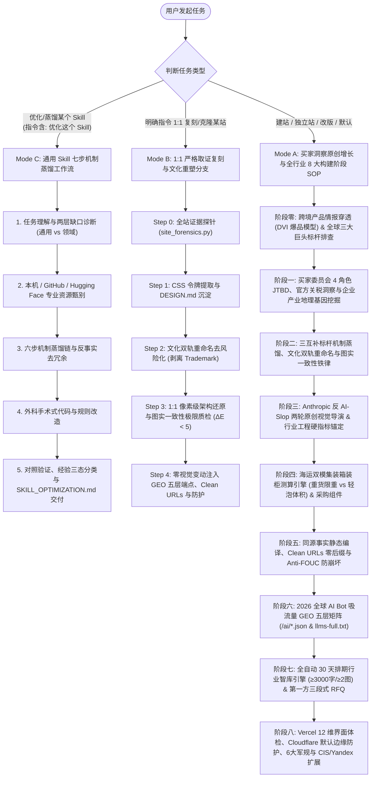

# B2B Global Brand Site Master · V3.0 全链路大一统旗舰版

将企业真实事实转化为海外大买家深度信任、能完成工程选型与直接询盘，且全球传统搜索与生成式 AI 引擎（ChatGPT Search、Perplexity、Claude、Google AI、Яндекс Нейро）能高置信引用的世界级品牌官网；同时具备跨领域通用 Skill 机制蒸馏与进化能力。

本版本完整融合了三大核心体系：
1. **`b2b-global-brand-site-master` (V2.2)**：22 大行业采购蓝图、RenWork V4 21 模块事实治理、同源静态编译器与 Cloudflare Workers 默认边缘防护；
2. **`b2b-limestone-geo-site-builder`**：从前置标杆情报发现、全球三大巨头解构、文化双轨重命名、工程标准锚定、重货/轻泡双模装柜算力到 GEO 五层吸流端点（`/ai/*.json` & `llms-full.txt`）的 **8 大构建阶段全行业通用 SOP**；
3. **`renwork-web-create-skill` (V4.3)**：**三轨路由矩阵（Mode A 原创 / Mode B 1:1 复刻 / Mode C 通用 Skill 蒸馏）**、B2B & B2C 跨境产品情报 DVI 引擎、采购委员会 4 大角色 JTBD、Anthropic `frontend-design` 反 AI-Slop 两轮设计法、Vercel `web-design-guidelines` 12 维界面体检审计器与 **全自动 30 天排期行业智库长文发布引擎**。

---

## 🏛️ 核心架构：三轨路由矩阵与 8 大构建阶段全景图



---

## 🚀 全生命周期 8+1 构建阶段详解 (Mode A & Mode B 贯通 SOP)

### 阶段零：跨境全链路产品情报穿透与全球三大巨头标杆排查
1. **B2B & B2C 跨境产品情报穿透（DVI 爆款模型）**：
   - 扫描五大信号源：**TikTok Shop**（高播病毒话题与开箱痛点）、**Amazon BSR & Movers**（1–3 星差评缺陷逆向改良）、**Google Trends**（Breakout 突变材质/功能词）、**Temu/Shein**（色彩趋势）、**全球海关提单 BOL**（HS 编码真实出货柜量）；
   - 按 7天（闪击）/ 14天（社交）/ 30天（主力）/ 60天（防守）/ 90天（壁垒）输出主力爆品矩阵与阶梯利润空间。详见 [`references/cross-border-product-intelligence.md`](references/cross-border-product-intelligence.md)。
2. **全球三大巨头标杆排查（Benchmark Reconnaissance）**：
   - 严禁盲目套用低端模板，锁定细分赛道三类互补标杆：
     - **标杆 1（技术规范与 GEO 第一引用源）**：吸纳其 CSI/ASTM/FDA/ISO 测试参数表、公差披露与 CAD/BIM 资源结构（如 `polycor.com`、`mcmaster.com`）；
     - **标杆 2（高端视觉美学与溢价天花板）**：吸纳其杂志级留白、字阶梯度与顶奢实景叙事（如 `eco-outdoor.com`、`bentgo.com`）；
     - **标杆 3（场景长尾词与选型指南之王）**：吸纳其按空间/工艺/应用维度的 Topic Clusters 分类架构（如 `mandarinstone.com`）。
   - **终极决策公式**：
     $$\text{出海品牌独立站} = \text{标杆 2 的视觉美学} + \text{标杆 1 的国际标准工程真相} + \text{标杆 3 的长尾分类架构} + \text{中国源头工厂产能与 FOB 出厂价优势}$$
   - 详见 [`references/benchmark-discovery-methodology.md`](references/benchmark-discovery-methodology.md)。

### 阶段一：买家委员会 4 大角色 JTBD、贸易关税洞察与企业基因挖掘
- **采购委员会 4 大角色专属弹药**：
  - *使用者 (End User)*：微距质感、人体工学、施工/使用维护图解；
  - *技术评估者 (Technical Evaluator)*：SGS/TÜV/ASTM 检测报告、材质证明书 (CoA)、公差与工况边界；
  - *商业决策者 (Decision Maker)*：私模保护、极速打样周期、自动化产线机群与产能看板；
  - *财务与物流角色 (Economic Buyer)*：阶梯 MOQ、20GP/40HQ 装柜实时测算器、港口直拖距离。
- **官方权威贸易数据源**：核验 WTO 关税、EU Access2Markets、USITC HTS 及采购季节倒推窗口（提前 60 天截流）。
- **三层数据隔离铁律**：严格区分**企业事实 (Firm Truth)**、**公开观察 (Public Observation)** 与**待验证假设 (Hypothesis)**；未知企业事实一律进入 `private/gaps.md`。详见 [`references/buyer-and-trade-research.md`](references/buyer-and-trade-research.md)。

### 阶段二：机制蒸馏、文化双轨重命名与图实一致性铁律
- **四种高阶机制蒸馏法**：对照学习（Top 10% vs 普通站）、反事实检查（删减不影响决策的冗余动效）、跨行业类比、失败蒸馏。详见 [`references/mechanism-distillation-and-creative-direction.md`](references/mechanism-distillation-and-creative-direction.md)。
- **文化双轨重命名（反侵权脱敏）**：彻底剥离对标站专有商标（Trademark），借助中国传统文化（营造法式、二十四节气、东方山河）或硬核工业美学建立双轨体系：
  - 主商品名：`[文化拼音/系列名] [表面工艺/结构功能] [标准品类词]`（如 `Guyu Tumbled Limestone Pavers`）
  - 副标题：`[意境英文] · [中文原名] ([色系/材质/肌理特征])`（如 `Spring Warm Cream · 谷雨`）
- **图实一致性铁律（$\Delta E < 5$）**：微距产品特写优先采用工厂实拍；配套空间场景图必须在色调、表面肌理、结构细节上与特写 **100% 像素级对齐**，严禁特写是黄色滚磨面而场景是灰色抛光面。

### 阶段三：Anthropic 反 AI-Slop 两轮视觉导演与工程标准锚定
- **四大强制任务上下文**：明确 ① 采购委员会 4 角色、② 390px/768px/1440px 断点、③ 完整 8 态交互（Default/Hover/Active/Focus-visible/Disabled/Loading/Empty/Error）、④ 真实物理材料约束。
- **两轮设计规划法（Two-Pass Design Planning）**：
  - *Pass 1*：确定品牌色与语义 Token、流式字阶与阅读宽度；
  - *Pass 2（反 AI-Slop 审视）*：坚决剔除无脑紫色渐变、千篇一律圆角软阴影卡片堆砌、虚假统计数字与冗余按钮；遵循 **“大胆用在一处，克制留给全局（Spend Boldness in One Place）”** 与主动语态功能性文案。详见 [`references/frontend-design-anti-slop.md`](references/frontend-design-anti-slop.md)。

### 阶段四：海运双模集装箱装柜测算引擎与采购组件
- 通过 `scripts/design_math.py` 提供确定性双模海运配载算力，严防重货按体积算柜引发超重爆柜：
  1. **轻泡/标准外箱模式 (`container`)**：针对餐厨便当盒、家电、箱包、日用品，按外箱尺寸（mm）、毛重（kg）、装箱数（pcs）与容积率同步计算 20GP / 40GP / 40HQ 容量；
  2. **重货限重硬瓶颈模式 (`stone-container`)**：针对天然石材、岩板、金属铸件等高密度重货（如石材 $\rho = 2,620\text{ kg/m}^3$，20GP 安全限重 `26,500 kg`，20mm 标板单柜安全上限 `480–504 m²`，30mm 约 `320–336 m²`）。

### 阶段五：同源事实静态编译器、Clean URLs 与 Anti-FOUC 防崩坏
- 同一套核准公开事实卡（`content/public-facts.json`）驱动 HTML、JSON-LD、Sitemap 与 AI 知识端点，内部字段（`source_refs`、`tenant_id`）绝不外泄；
- **全站默认 Clean URLs（零 `.html` 后缀）**：所有站内内链、Canonical、`og:url`、JSON-LD `url` 与 `sitemap.xml` 严禁暴露 `.html`；
- **Anti-FOUC 四大防线**：CSS/JS 强制带内容 SHA-256 哈希（`?v={hash}`），隐藏抽屉/弹窗内联 `display:none!important`，前 1024 字节声明 UTF-8，图标优先用内联 SVG。

### 阶段六：2026 全球 AI Bot 吸流量 GEO 五层技术矩阵
开启 `"llms": true` 并执行 `--release` 构建时，自动编译五层截流体系：
1. **爬虫协议层 (`robots.txt` & `sitemap.xml`)**：清晰声明搜索与 AI 爬虫规则及规范 Sitemap；
2. **双轨 LLM 协议层**：轻量导航 `/llms.txt` + 全量工程采购手册 `/llms-full.txt`；
3. **四大机器可读 JSON API 层**：`/ai/summary.json`、`/ai/products.json`、`/ai/faq.json`、`/ai/vendor-comparison.json`；
4. **深度语义图谱层 (`Schema.org`)**：`WebPage` + `Organization` + `Product` + `FAQPage` + `NewsArticle`；
5. **Princeton GEO 三句式答案块与数据铁律**：市场价格/运费估算强制附带 *Indicative 估算免责声明* 并导向正式询价。详见 [`references/geo-ai-citation-playbook.md`](references/geo-ai-citation-playbook.md)。

### 阶段七：全自动 30 天排期行业智库引擎与第一方三段式 RFQ
1. **30 天排期行业前沿智库发布引擎 (`scripts/scheduled_content_engine.py`)**：
   - 围绕 **6 大核心选题支柱**（B/C 端政策法规、新材料工程、畅销款结构拆解、B 端平台采购趋势、C 端爆款痛点改良、30/60/90 天排产预测）储备 30 天深度图文队列（`content/scheduled-news/queue.json`）；
   - **硬性双重深度门禁**：每篇正文字数 **≥ 3,000 字**、配图 **≥ 2 张高清工程图**（带显式 `width`/`height` 与描述性 `alt`）；
   - 支持 `--audit-queue` 门禁审计、`--publish-due` 定时转正发布（自动生成 Clean URLs 页面并同步 `sitemap.xml`）及 `--export-admin` 云端看板数据导出。详见 [`references/scheduled-news-and-intelligence-engine.md`](references/scheduled-news-and-intelligence-engine.md)。
2. **第一方 RFQ 询盘全链路与三段式真实验收**：
   - 未配后端时诚实采用 `email_draft` 邮件草稿模式；
   - 生产环境接入 `http` 模式（Cloudflare Worker `/api/inquiry` + Turnstile `siteverify` 验签 + 蜜罐 + 邮件投递），执行 **“① 假 token 探针返回 403 $\rightarrow$ ② 真机人工通过 Turnstile 提交 $\rightarrow$ ③ 销售收件箱收到真实邮件”** 三段式验收。

### 阶段八：Vercel 12 维界面体检、默认边缘防护与 6 大防错军规
- **Vercel `web-design-guidelines` 12 维自动化审计**：运行 `scripts/layout_typography_auditor.py --strict` 检查语义标签、Icon 按钮 `aria-label`、表单 `<label>` 绑定、`:focus-visible`、禁用 `transition: all`、微排版省略号 `…`、图片显式宽高防 CLS 及 Clean URLs 零 `.html` 残留。详见 [`references/web-design-guidelines-audit.md`](references/web-design-guidelines-audit.md)。
- **默认站点边缘防护**：每次构建生成 Cloudflare Workers 防护发布包（公开路径白名单、读取/询盘独立限流、防 iframe 镜像嵌套 `frame-ancestors 'none'`）。详见 [`references/site-protection.md`](references/site-protection.md)。
- **6 大不可违反防错军规**：详见 [`references/failure-cases-and-guardrails.md`](references/failure-cases-and-guardrails.md)。

---

## 🧬 Mode C：通用 Skill 七步机制蒸馏与进化工作流

当用户输入包含 `优化这个 Skill：〈路径或仓库〉` 或要求升级任意领域 Skill 时，按 [`references/skill-optimization.md`](references/skill-optimization.md) 执行七步闭环：
1. **任务理解与基准诊断**：读取目标 Skill 的 `SKILL.md`、`references/`、`scripts/`、测试与历史失败案例；
2. **两层能力缺口诊断**：区分**通用维度**（流程、证据、工具、验证、信噪比）与**领域维度**（**严禁向非外贸网站类 Skill 强加买家研究、关税或 SEO/GEO 规则**）；
3. **本机 / GitHub / Hugging Face 资源甄别**：核实源码、Commit、许可与真实依赖，区分 Agent Skill、数据集与模型；
4. **六步机制蒸馏链**：`来源观察 → 有效机制 → 适用条件 → 目标 Skill 适配 → 产物具体变化 → 验证证据`；
5. **外科手术式代码与规则改造**：基于标准库实现确定性脚本与防御性断言；
6. **对照验证与经验三态分类**：区分 **[已验证 Verified]**、**[推导规则 Inferred]** 与 **[待试验 Hypothetical]**，并可通过 `scripts/record_learning.py` 登记；
7. **交付报告**：按 [`templates/SKILL_OPTIMIZATION.md`](templates/SKILL_OPTIMIZATION.md) 输出完整审计与验证报告。

---

## 按需读取导航

1. **8 阶段 SOP、标杆发现与跨行业 5 步母模板**：读 [标杆发现与 8 阶段通用 SOP](references/benchmark-discovery-methodology.md) 和 [6 大失败案例与防错军规](references/failure-cases-and-guardrails.md)。
2. **跨境产品情报与买家/贸易研究**：读 [跨境全链路产品情报引擎](references/cross-border-product-intelligence.md)、[买家与贸易研究](references/buyer-and-trade-research.md) 与 [BUYER_STRATEGY 模板](templates/BUYER_STRATEGY.md)。
3. **启动及选择行业**：读 [行业选择与交付规则](references/industry-routing.md)，从 [22 行业配置](assets/industries.json) 只取匹配项（含 `bento` 便当盒餐厨与 `limestone` 天然石灰石建材）。
4. **事实治理与知识库**：读 [知识与资产契约](references/knowledge-assets.md) 与 [运行与迁移](references/runtime.md)。
5. **原创视觉设计、1:1 复刻契约与 12 维界面体检**：读 [机制蒸馏与创意方向](references/mechanism-distillation-and-creative-direction.md)、[Anthropic 反 AI-Slop 设计规范](references/frontend-design-anti-slop.md)、[Vercel 12 维界面体检指南](references/web-design-guidelines-audit.md)、[1:1 像素复刻契约](references/pixel-clone-contract.md)、[品牌及页面模板](references/site-blueprints.md) 与 [网页设计规范](references/web-design.md)。
6. **GEO 五层矩阵、30 天排期智库、安全防护与上线验收**：读 [GEO 五层吸流手册](references/geo-ai-citation-playbook.md)、[30 天排期智库发布引擎](references/scheduled-news-and-intelligence-engine.md)、[采购组件](references/procurement-components.md)、[默认站点防护](references/site-protection.md)、[搜索与发布验收](references/search-release.md) 与 [最新平台核验](references/search-current.md)。
7. **通用 Skill 优化与融合**：读 [通用 Skill 优化生命周期](references/skill-optimization.md)、[研究依据](references/research.md)、[V2 融合差异](references/fusion-v2.md) 与 [SKILL_OPTIMIZATION 模板](templates/SKILL_OPTIMIZATION.md)。

---

## 一条命令与全链路工具集

```bash
# 1. 查看 22 大行业配置并初始化企业项目
python3 scripts/sitekit.py industries
python3 scripts/orchestrator.py --name "Example Company" --intro-file /path/intro.txt --industry limestone --logo /path/logo.png --out /path/company-project

# 2. 编译草稿或发布候选 (当 site.json 中 llms=true 时，--release 自动生成 llms.txt, llms-full.txt 及 /ai/*.json)
python3 scripts/orchestrator.py --project /path/company-project
python3 scripts/orchestrator.py --project /path/company-project --release

# 3. 站点结构校验 + Vercel 12 维 UI/UX 与 Clean URLs 严格体检
python3 scripts/validate_site.py /path/site-output --release --domain https://example.com
python3 scripts/layout_typography_auditor.py --strict /path/site-output

# 4. 设计数学、防御性 URL 拼接与双模集装箱装柜算力 (外箱体积模式 + 重货石材限重模式)
python3 scripts/design_math.py contrast '#334155' '#ffffff'
python3 scripts/design_math.py fluid 36 64 360 1440
python3 scripts/design_math.py safe-url https://example.com products/item
python3 scripts/design_math.py container --length 540 --width 380 --height 420 --weight 14.5 --pcs 24
python3 scripts/design_math.py stone-container --area 480 --thickness 20 --density 2620

# 5. 30 天排期行业智库长文队列审计与定时发布引擎 (≥3,000字 & ≥2图/篇)
python3 scripts/scheduled_content_engine.py --audit-queue
python3 scripts/scheduled_content_engine.py --publish-due --domain example.com --brand "Example Brand"

# 6. Mode B 标杆单页取证探针 & 本地 RFQ 守护服务
python3 scripts/site_forensics.py https://example.com /tmp/evidence-capture
python3 scripts/rfq_daemon.py --port 8012 --emails info@example.com

# 7. 全量回归测试套件
python3 tests/check_pipeline.py
python3 tests/check_validator.py
python3 tests/check_record_learning.py
node tests/check_estimator.mjs
node tests/check_inquiry.mjs
node tests/check_protection.mjs
python3 scripts/design_math.py self-test
python3 scripts/scheduled_content_engine.py --self-test
```
