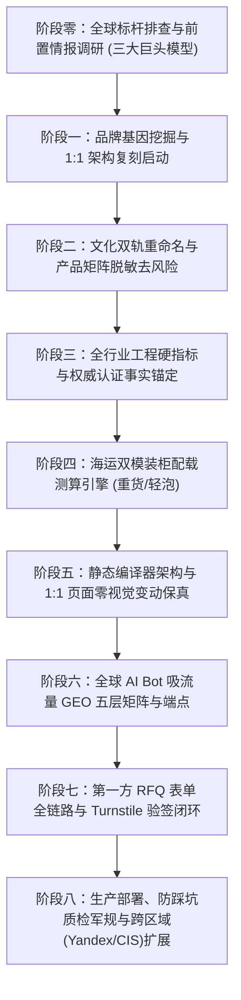

# 全行业标杆发现与 8 大构建阶段通用 SOP (Benchmark Discovery & 8-Stage Universal SOP)

本文档完整融合了 **Fujian Tianya Cultural Stone Co., Ltd. (`tianyalimestone.com`)** 与 **Naike Custom Bento Factory (`custombentofactory.com`)** 在全球标杆定位与独立站构建过程中的核心方法论，将“从前置情报发现、全球三大巨头解构、文化双轨重命名、工程标准锚定、双模海运配载、静态编译保真、GEO 五层吸流端点、第一方 RFQ 闭环到跨行业泛化”沉淀为适用于全部 22 大外贸制造行业的通用 SOP。

---

## 🏛️ 一、 全生命周期 8+1 构建阶段全景图



---

## 🔍 二、 阶段零：全球标杆排查与前置情报调研 (Benchmark Reconnaissance)

许多中国外贸工厂建站时习惯套用泛滥的通用模板，导致全站呈现“低价白牌代工厂”气质。正确的起点是经历严密的前置情报穿透，锁定全球细分赛道的三大标杆。

### 1. 穿透细分赛道的核心启动 Prompt
```markdown
[企业现有域名/产品简介] 核心品类 [核心品类名，如 limestone / bento box / CNC parts] 全球 B2B 5 大热门前沿趋势及其专业的 B2B 站点排行，特别是 SEO 和 GEO 带来流量大的站点
```

### 2. 全球自然流量与大模型引用“三大巨头对标模型”
任何制造行业（石材、餐厨、机械、五金、卫浴、包装等）的全球流量格局，均可解构为以下三种互补角色：

| 标杆角色 | 核心流量与商业特征 | 我们吸纳的核心价值 | 跨行业典型案例 |
|---|---|---|---|
| **1. 技术规范与 GEO 第一引用源**<br>(Engineering Authority) | 垄断公建/工业标准（CSI 规范、ASTM/ISO/FDA 测试报告、CAD/BIM 模型、EPD 碳足迹），是 AI 搜索引擎最信任的工程事实源。 | **吸纳其工程硬核**：<br>引入第三方实验室测试指标、公差/物理参数对比表与可下载工程图集。 | 石材：`polycor.com`<br>五金：`mcmaster.com` |
| **2. 高端设计美学与溢价天花板**<br>(Visual & Pricing Ceiling) | 垄断极简杂志级留白、高级衬线/无衬线字阶与顶奢实景案例，终端溢价通常为中国工厂出厂价的 **3–6 倍**。 | **吸纳其视觉与版式**：<br>1:1 解构其留白比例、色彩语义 Token、沉浸式卡片与空间选型体验。 | 石材：`eco-outdoor.com`<br>便当盒：`bentgo.com` |
| **3. 场景长尾词与选型指南之王**<br>(Topic Cluster King) | 按应用场景、表面工艺、规格尺寸建立极度密集的主题集群（Topic Clusters），垄断 "Which / How much / vs" 选型流量。 | **吸纳其分类与内链逻辑**：<br>建立工艺/场景聚合专区与结构化采购指南博客 (`/blog/`)。 | 石材：`mandarinstone.com`<br>餐具：`lunchboxmanufacturer.com` |

### 3. 终极建站决策公式
$$\text{中国出海品牌独立站} = \text{标杆 2 的视觉美学} + \text{标杆 1 的国际标准工程真相} + \text{标杆 3 的长尾分类架构} + \text{中国源头工厂产能与 FOB 出厂价壁垒}$$

---

## 🏗️ 三、 阶段一至阶段八：标准执行细则

### 阶段一：概念起意与品牌基因挖掘 (Conceptualization & Brand Truth)
* **产业地理锚点**：明确标注中国核心产业带坐标（如福建水头世界石都、浙江宁波/慈溪家电餐厨、广东阳江五金等）及距核心出海港口（厦门港、宁波港、深圳盐田港）的直达拖车距离；
* **自营产能与设备事实**：核实并披露排锯、五轴数控桥切机、高精注塑机群、月产能与交期边界；
* **聚焦高毛利核心品类**：以标杆信息架构为蓝本，对杂乱品类做“减法”，主推核心优势品类，延伸品类仅作清晰索引。

### 阶段二：文化双轨重命名与产品矩阵脱敏 (Dual Trade Naming)
* **核心目的**：彻底剥离对标网站专有商标（Trademark）与版权图片，杜绝海外侵权风险，同时赋予产品东方文化或现代工业美学溢价。
* **双轨命名标准公式**：
  - **主商品名（国际工程/商业规范）**：`[文化拼音/品牌词] [表面工艺/结构功能] [标准品类词]`（例：`Guyu Tumbled Limestone Pavers`）
  - **副标题（文化意象与特征）**：`[意境英文] · [中文原名] ([色系/材质/肌理特征])`（例：`Spring Warm Cream · 谷雨`）
* **图实一致性极限质检（铁律）**：
  - 微距产品特写必须采用工厂真实高清实拍；
  - 对应的空间应用场景图（泳池、庭院、厨房、车间）必须在材质、色调、表面反光度、边缘倒角上与产品特写 **100% 像素级对齐**（色差 $\Delta E < 5$），严禁特写是黄色仿古面而场景图是灰色抛光面。

### 阶段三：工程硬指标与物理测试事实锚定 (Engineering Truths)
* 拒绝空洞形容词（如 "high quality", "best price"），全站绑定经核实的权威标准：
  - **建材石材**：ASTM C97（吸水率 `<0.22%`、体积密度 `2.62–2.65 g/cm³`）、ASTM C170（干湿态抗压强度）、ASTM C880（抗折强度）、ASTM C666 / ГОСТ 30629（抗冻融循环 `F100`）、AS 4586（湿态摆锤防滑 `P4/P5`）、EN 13501-1（`A1` 级不燃）；
  - **餐厨便当盒**：FDA 21 CFR 177.1520、LFGB、CPSIA、BPA-Free、`-50kPa` 真空防漏测试、Disney FAMA / BSCI 验厂事实；
  - **机械五金**：ISO 2768 公差等级、材质牌号光谱报告、主轴定位精度与工况边界。

### 阶段四：双模海运装柜配载测算引擎 (Dual-Mode Container Logistics Math)
* 通过 `scripts/design_math.py` 提供双模确定性算力：
  1. **重货模式 (`stone-container`)**：针对石材、板材、金属铸件等高密度重货（Deadweight Cargo），以集装箱**限重红线**（如 20GP 限重 `26,500 kg`）为唯一硬瓶颈，自动计算 ISPM 15 熏蒸木箱数与单柜安全面积上限（如 20mm 石灰石约 `480–504 m²/20GP`，30mm 约 `320–336 m²/20GP`）；
  2. **轻泡/标准外箱模式 (`container`)**：针对便当盒、家电、箱包、日用品，按外箱长宽高（mm）、毛重（kg）、装箱数（pcs）与容积率（`0.88`）同步测算 20GP / 40GP / 40HQ 装载量。

### 阶段五：静态编译器架构与 1:1 页面零视觉变动保真 (Compiler Architecture)
* 同一套核准事实卡（`content/public-facts.json`）驱动 HTML、Schema.org JSON-LD、`sitemap.xml` 与 AI 知识端点；
* **零视觉变动原则**：在对已有高水准设计页面做 SEO/GEO 赋能时，100% 锁定既有 CSS 网格与排版样式，仅针对 `<head>` 元数据、结构化图谱与机器可读端点做无损注入；
* **防排版崩坏基线 (Anti-FOUC)**：CSS/JS 强制附加内容 SHA-256 哈希（`?v={hash}`），隐藏式抽屉与弹窗在 `<head>` 内联声明 `display:none!important`。

### 阶段六：2026 全球 AI Bot 吸流量 GEO 五层技术矩阵 (GEO 5-Layer Matrix)
详见 [`references/geo-ai-citation-playbook.md`](geo-ai-citation-playbook.md)：
1. **第一层（爬虫协议层）**：`robots.txt` 清晰声明搜索与 AI 爬虫策略及 Sitemap；
2. **第二层（双轨 LLM 协议层）**：生成轻量导航 `/llms.txt` 与深度工程技术手册 `/llms-full.txt`；
3. **第三层（机器可读 JSON API 层）**：自动编译 `/ai/summary.json`、`/ai/products.json`、`/ai/faq.json`、`/ai/vendor-comparison.json`；
4. **第四层（深度语义图谱层）**：页面级 `WebPage` / `Organization` / `Product` / `FAQPage` JSON-LD；
5. **第五层（事实锚点工程正文与数据铁律）**：正文采用 Princeton GEO 三句式高密度事实块；价格与运费估算强制附带 *Indicative 估算免责声明* 并引导正式报价。

### 阶段七：第一方询盘后端全链路 (First-Party RFQ · Turnstile + Worker)
* 默认支持零依赖 `email_draft` 模式；生产环境推荐接入第一方 Cloudflare Worker `/api/inquiry` + Turnstile 服务端验签（`siteverify` + `CF-Connecting-IP`）+ 隐形蜜罐（Honeypot）+ 邮件投递；
* **三段式端到端验证（缺一不可）**：
  1. 假 token 探针测试（POST 伪造 token 必须返回 `403`）；
  2. 真机浏览器人工通过 Turnstile 提交测试（验证前端清空与成功回执）；
  3. 客户通知邮箱确认收到真实询盘邮件。

### 阶段八：生产运维、质检军规与多区域扩展 (Ops, Guardrails & CIS/Yandex)
* 发布前强制执行 `scripts/validate_site.py --release --domain https://...`（必须 0 errors）及全套单元回归测试；
* 多智能体协作严格执行改前 `md5sum` 校验、服务端备份与 handoff 记录；
* 针对俄罗斯、哈萨克斯坦、乌兹别克斯坦等欧亚经济联盟（EAEU/CIS）市场，可按需开启 Yandex SEO（`Clean-param`、`hreflang`、IndexNow 秒级推送）与 ГОСТ 标准对标矩阵。

---

## 🚀 四、 跨行业对标 5 步万能提示词链条 (Universal Prompt Chain)

任何外贸制造企业均可直接按以下 **5 轮标准提示词** 完成从零到世界级独立站的构建：

### 第 1 轮：穿透细分品类 Top 3 标杆
```markdown
【企业自身官网/简介】：[填写现有网址或公司介绍]
【核心品类】：[例如：天然石灰石地铺 / 不锈钢便当盒 / 五轴精密CNC零件]

请基于我们工厂现有品类，深度研究该细分品类全球 B2B 5 大热门前沿趋势及其专业的 B2B 站点排行，特别是 SEO 和 GEO 带来流量大的顶级站点。
要求：
1. 找出 3 家分别代表【技术工程规范权威】、【高端视觉与设计天花板】、【场景化长尾词之王】的海外本土标杆品牌；
2. 列出他们的官网链接、客单价溢价区间（对比中国出厂价）、核心产品线分类；
3. 分析海外专业采购商为什么会指定采购他们？
```

### 第 2 轮：选定视觉天花板 1:1 架构复刻
```markdown
我们将以【标杆官网链接】为架构与设计标杆，使用 $b2b-global-brand-site-master 建立我们的独立站【目标域名】：
1. 借鉴其版式留白、CSS 网格、字阶梯度与核心分类维度；
2. 网站的企业主体、工厂实力、设备产线、检测证据全面采用我方【自身工厂真实资料】，未核实信息列入缺口表；
3. 聚焦在该核心品类，生成完整产品矩阵与采购转化路径。
```

### 第 3 轮：文化双轨重命名（彻底规避侵权）
```markdown
/plan 我们要彻底剔除原标杆站点的所有专有商品名称与 Trademark，杜绝侵权风险。
请基于【中国传统文化 / 营造法式 / 二十四节气 / 现代工业硬核美学】为我们主力 SKU 进行全新的双轨命名：
- 主商品名（国际工程规范）：`[文化拼音/系列名] [工艺/功能] [标准品类词]`
- 副标题（文化意境）：`[意境英文] · [中文原名] ([材质/纹理/色系说明])`
- 关联对应的国际标准检测参数（如 ASTM / CE / FDA / ISO）。先出规划表，确认后再批量生成。
```

### 第 4 轮：真实产品图与应用场景 1:1 严格对齐质检
```markdown
产品特写图优先使用我们工厂提供的真实高清实拍。
请对全站每一款产品执行“图实严格一致性核查”：
1. 逐一核对每款产品的微距特写图与空间应用渲染图；
2. 严禁出现产品特写与场景图在材质、色泽、表面工艺、结构细节上脱节的问题，确保 100% 像素级对应。
```

### 第 5 轮：构建面向全球 AI 引擎的 GEO 五层流量截流端点
```markdown
在保持前端视觉设计与排版 100% 不变的前提下，为独立站开启全球 GEO 五层吸流量体系：
1. 开启 llms 模式，自动编译 `/llms.txt` 与 `/llms-full.txt` 深度技术手册；
2. 生成 `/ai/summary.json`、`/ai/products.json`、`/ai/faq.json`、`/ai/vendor-comparison.json` 四大机器可读端点；
3. 接入 `scripts/design_math.py` 集装箱装柜配载算力（重货按重量上限、轻泡按外箱体积）；
4. 执行 Clean URLs（无 .html 后缀）、CSS 内容哈希防缓存崩坏与 `validate_site.py --release` 全量验收。
```
