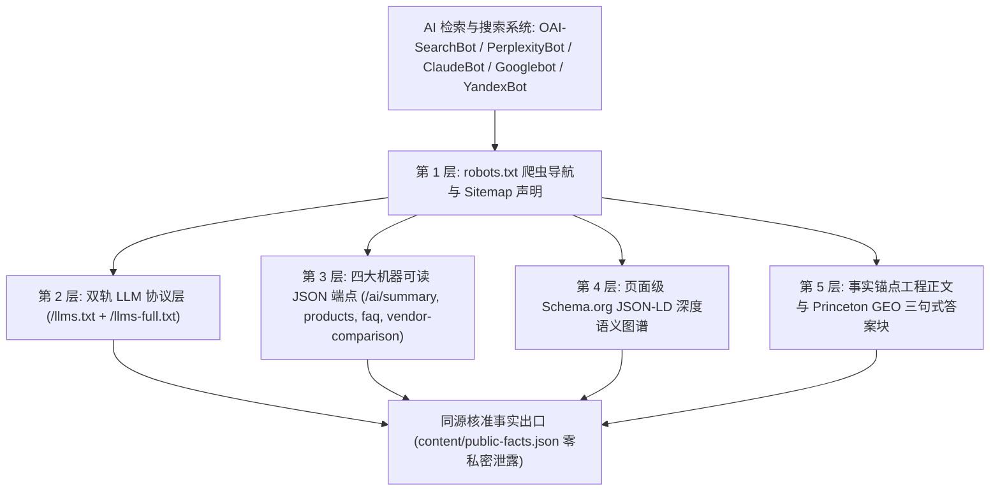

# 全球 AI 搜索引擎 GEO 五层吸流体系与机器可读端点规范 (GEO 5-Layer AI Citation Playbook)

## 1. 2026 全球 AI 搜索引擎工作机制与 B2B 寻源范式

海外专业采购商、建筑师、工程总包商与品牌买手已广泛通过 **Perplexity AI、ChatGPT Search、Claude、Google Gemini、DeepSeek 及 Яндекс Нейро (Yandex Neuro)** 进行供应商寻源与技术规格对比。

大语言模型检索增强生成（RAG）管道的引用优先级取决于三大核心要素：
1. **意图解析与行业实体链接 (Entity Linking)**：识别专业采购术语、国际检测标准号（如 `ASTM C97`, `FDA 21 CFR 177.1520`, `ISO 2768`, `ГОСТ 30629-2011`）及具体应用场景。
2. **机器可读事实抓取 (Machine-Readable Fact Ingestion)**：优先抓取低延迟、免 JS 渲染、结构清晰的 Markdown 与 JSON 知识端点（`/llms.txt`、`/llms-full.txt`、`/ai/*.json`）。
3. **可信度仲裁与事实对齐 (Citation Arbitration)**：淘汰空洞口号与自相矛盾的数据，优先引用具备确定性测试条件、装柜配载公式、清晰交期边界且前后文 100% 一致的源头工厂。

---

## 2. GEO 五层吸流量技术矩阵

### 第 1 层：爬虫协议导航层 (`robots.txt` & `sitemap.xml`)
- 明确区分搜索爬虫与训练爬虫策略（`training_bot_policy`），默认保障公开页面与搜索爬虫正常抓取；
- 全站 URL 严格执行 **Clean URLs（无 `.html` 后缀）**，所有 `<loc>`、`<link rel="canonical">` 与 JSON-LD `url` 100% 对齐；
- 针对俄语及中亚/独联体（CIS/EAEU）多语言站点，支持注入 Yandex `Clean-param` 指令与 IndexNow 密钥验证文件。

### 第 2 层：双轨 Markdown 协议层 (`llms.txt` & `llms-full.txt`)
当 `content/site.json` 中设置 `"llms": true` 并执行 `--release` 构建时，`scripts/site_compiler.py` 自动从经核准的公开事实卡生成双轨索引：
- **`/llms.txt`（轻量导航索引）**：包含企业名称、核心页面规范链接列表以及 `/ai/*.json` 机器可读端点入口；
- **`/llms-full.txt`（深度工程与采购手册）**：汇总企业域名、联系通道、布局范式及全部已批准公开事实（`kb_id`、结论 `conclusion`、适用条件 `conditions`、更新时间 `updated_at`），供 RAG 系统一次性长上下文摄取。

### 第 3 层：四大无损机器可读 JSON API (`/ai/*.json`)
由编译器同源导出，严格过滤内部字段（绝不包含 `source_refs`、`tenant_id`、`private_notes` 等私有属性）：
1. **`/ai/summary.json`**：企业主体概览、主营行业、语言、页面总数、已核准事实数及全套 AI 端点 URL 字典；
2. **`/ai/products.json`**：首页、集合页与产品页的结构化清单，内嵌每页绑定的已核实规格参数（`parameter`、`value`、`conditions`）；
3. **`/ai/faq.json`**：基于已核实公开事实自动生成的结构化采购问答集，每条回答均携带明确的适用条件与更新时间；
4. **`/ai/vendor-comparison.json`**：提供当前行业的标准评估维度（`evaluation_dimensions`）、所需证据类型（`required_evidence_types`）及本企业已核实指标，不捏造竞争对手虚假数据。

### 第 4 层：页面级 Schema.org JSON-LD 语义图谱
- 每个发布页面自动注入与 `<title>`、`<meta name="description">`、`<link rel="canonical">` 严格一致的 `WebPage` 与 `Organization` 节点；
- 行业扩展页面支持按真实内容注入 `Product`（含 `additionalProperty` 物理测试指标）、`ItemList`、`FAQPage` 与 `BlogPosting`。

### 第 5 层：事实锚点工程正文与内容数据铁律
- **Princeton GEO 三句式高密度回答结构**（提升 +35%~40% AI 引用率）：
  1. *第一句（直接结论与实体锚定）*：明确说明企业的制造/供应范围与核心工艺；
  2. *第二句（量化测试证据与标准号）*：给出带标准编号与测试条件的实测值（如 `ASTM C97 water absorption < 0.22%` 或 `FDA 21 CFR 177.1520 food-grade PP`）；
  3. *第三句（商业与物流履约边界）*：说明 MOQ、交期区间、20GP/40HQ 单柜装载量及样品申领路径。
- **内容数据铁律（强制执行）**：
  - 凡涉及市场价格区间、海运/铁路运费、行业对比估算，必须明确标注为 *Indicative 估算（附可见免责声明）* 并导向正式报价，绝不把估算冒充客户确认承诺；
  - 站内所有技术长文（`/blog/`）、FAQ 与产品页的物理参数、认证口径、MOQ、交期必须与 `public-facts.json` 100% 一致，无法溯源的绝对化数字一律改写为定性说明或列入缺口表。
